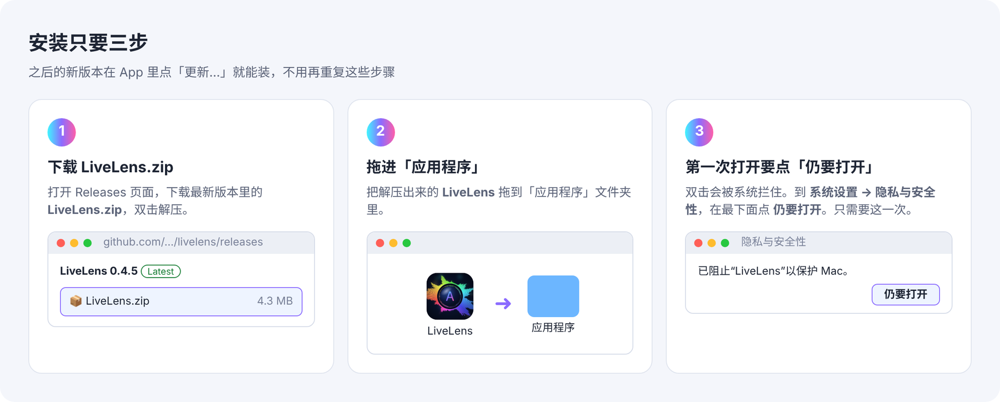
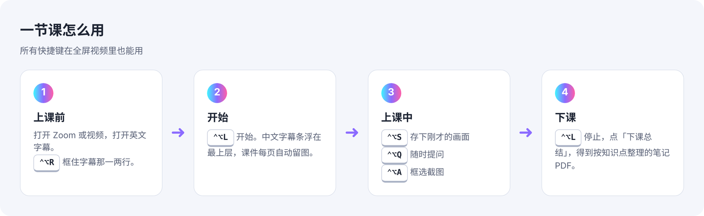
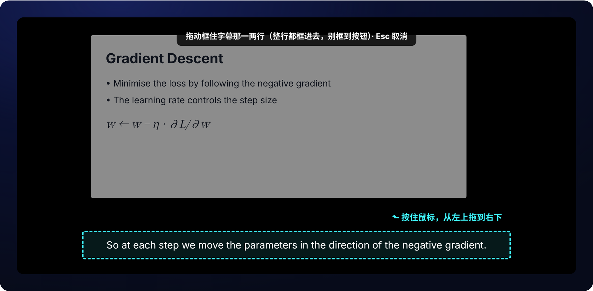
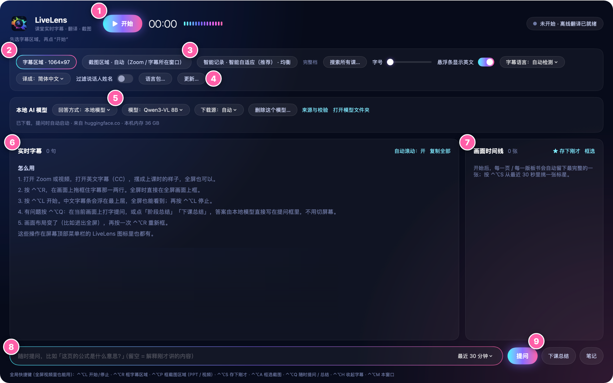
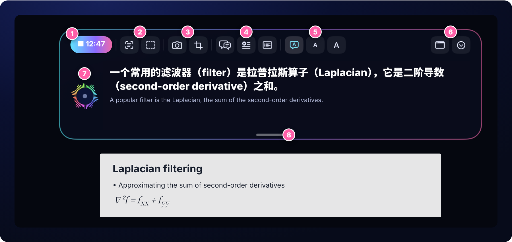
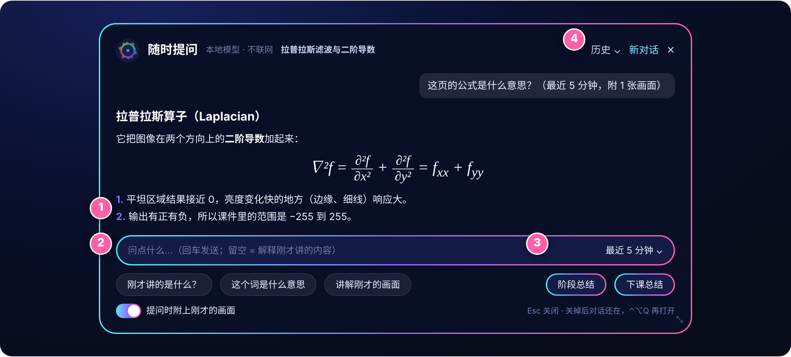
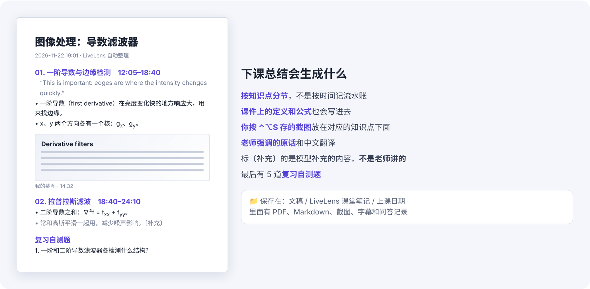

# LiveLens 课堂助手（Mac）

上英文网课时用的小助手。它读取屏幕上的英文字幕，实时翻成中文显示在一条悬浮字幕条上；自动保存每一页课件；听不懂的地方可以随时提问；下课后整理出一份按知识点分节的笔记 PDF。

翻译、提问和总结都在你自己的电脑上完成，不花钱，上课内容不会上传到任何地方。只有下载语言包、模型和更新时才会联网。

> 主窗口和字幕条的图取自 0.4.5 的实际界面，其余是示意图。

## 目录

- [需要什么](#需要什么)
- [安装](#安装)
- [第一次打开要做的三件事](#第一次打开要做的三件事)
- [一节课怎么用](#一节课怎么用)
- [主窗口上都有什么](#主窗口上都有什么)
- [悬浮字幕条](#悬浮字幕条)
- [随时提问](#随时提问)
- [下课总结和笔记](#下课总结和笔记)
- [快捷键](#快捷键)
- [课上没有字幕怎么办](#课上没有字幕怎么办)
- [更新](#更新)
- [常见问题](#常见问题)
- [隐私与课堂规定](#隐私与课堂规定)

## 需要什么

- macOS 15（Sequoia）或更新的系统
- 上课的软件能显示英文字幕（Zoom 的 CC、视频网站的字幕都可以）
- 想用提问和下课总结：内存 8 GB 以上，建议 16 GB；磁盘留出 2–7 GB 放模型

只要实时中文字幕的话，不下载模型也能用。

## 安装

1. 打开 [Releases 页面](https://github.com/ryancamus12138-sketch/livelens/releases/latest)，下载 **LiveLens.zip**，双击解压。
2. 把解压出来的 **LiveLens** 拖进「应用程序」文件夹。
3. 双击打开。第一次会被系统拦住，因为这个 App 没有交给苹果公证。打开 **系统设置 → 隐私与安全性**，拉到最下面，点 **仍要打开**。这一步只需要做一次。

## 第一次打开要做的三件事

**1. 允许屏幕录制。** LiveLens 靠"看"屏幕上的字幕来工作，所以系统会请求屏幕录制权限。到 **系统设置 → 隐私与安全性 → 屏幕与系统录音** 里打开 LiveLens，然后退出并重新打开 LiveLens。它不录视频也不录音，只截取你框选的字幕区域和课件画面。

**2. 下载语言包。** 在主窗口点 **语言包…**，按提示下载「英语 → 中文」的离线翻译包。只需要下载一次。

**3. 下载模型（可选）。** 想用提问和下课总结，在主窗口的「本地 AI 模型」那一行选一个模型，点 **下载**。运行模型需要的组件会跟着一起自动下载。

| 你的 Mac 内存 | 选哪个 | 大小 |
|---|---|---|
| 16 GB 或更多 | Qwen3-VL 8B（效果最好） | 约 6 GB |
| 8–16 GB | Qwen3-VL 4B | 约 3 GB |
| 8 GB，想要最快 | Qwen3-VL 2B | 约 1.5 GB |

下载慢的话，把「下载源」换成 hf-mirror 或 ModelScope。下载中断了再点一次会接着下。

## 一节课怎么用

**1. 上课前：框住字幕。** 打开 Zoom（或视频），打开英文字幕。按 **⌃⌥R**，屏幕会变暗，用鼠标拖一个框，把字幕那一两行整行框进去。框大一点没关系，但别框到按钮和人像。

框的位置会被记住。下次上课窗口布局没变，就不用重新框；窗口挪动或改了大小，要重新框一次。

**2. 开始。** 按 **⌃⌥L**。中文字幕条会浮在屏幕最上层，全屏上课时也看得到。

**3. 上课中。** 课件每翻一页，LiveLens 会自动留下最完整的一张。你自己想留的画面按 **⌃⌥S**，有问题按 **⌃⌥Q** 提问。

**4. 下课。** 再按一次 **⌃⌥L** 停止，然后点 **下课总结**。

这些快捷键在全屏画面里也能用，不需要切回 LiveLens 的窗口。

## 主窗口上都有什么

| 编号 | 是什么 | 用来做什么 |
|---|---|---|
| 1 | 开始 / 停止 | 和 ⌃⌥L 一样。旁边是已经上了多久 |
| 2 | 字幕区域 | 框选字幕的位置，和 ⌃⌥R 一样。框好后会显示框的大小 |
| 3 | 智能记录 | 自动截图的方式和数量，一般用默认的「智能自适应」就行。「用本地模型精修译文」的开关也在这里 |
| 4 | 语言包 / 更新 | 下载离线翻译语言包；检查并安装新版本 |
| 5 | 本地 AI 模型 | 选模型、选下载源、下载或删除模型 |
| 6 | 实时字幕 | 这节课所有的字幕，中英对照，可以一键复制 |
| 7 | 画面时间线 | 自动保存的课件和你自己截的图 |
| 8 | 提问框 | 在主窗口里直接提问，右边可以选让模型参考最近多久的内容 |
| 9 | 下课总结 | 生成这节课的笔记；旁边的「笔记」打开保存笔记的文件夹 |

第一行其余的按钮：**截图区域** 可以只框课件那一块（⌃⌥P），这样老师的视频小窗不会干扰自动截图；**搜索所有课** 在以前上过的课里找内容；**字号** 调字幕条的字大小；**悬浮条显示英文** 控制字幕条上要不要带英文原文；**字幕语言** 和 **译成** 用来换语言；字幕里老是混进老师的名字时，打开 **过滤说话人姓名**。

## 悬浮字幕条

| 编号 | 说明 |
|---|---|
| 1 | 开始 / 停止，上课时显示已经上了多久 |
| 2 | 框字幕区域（⌃⌥R）；框课件区域（⌃⌥P） |
| 3 | 存下刚才的画面（⌃⌥S）；框选截图（⌃⌥A） |
| 4 | 提问（⌃⌥Q）；阶段总结；下课总结 |
| 5 | 显示或隐藏英文原文；字号变小；字号变大 |
| 6 | 打开主窗口（⌃⌥M）；收起字幕条（⌃⌥H） |
| 7 | 大字是中文译文，下面的小字是英文原文。专业名词会在括号里保留英文 |
| 8 | 上下拖这里可以把字幕条拉高，多显示几行；拖左右边缘可以拉宽 |

按钮只有图标，鼠标停在上面会显示它是做什么的。字幕条拉得很窄时，只会留下最常用的几个按钮。

字幕条可以拖到屏幕任何位置，盖在原来的英文字幕上也没关系，LiveLens 截图时会避开自己。嫌挡画面时按 **⌃⌥H** 收起，收起后仍然在识别和记录。

**关于翻译的准确度。** 每句话会先用苹果的离线翻译马上显示出来，然后本地模型结合前后文和课件上的术语再修一遍，修好后替换掉原来的译文。所以有时会看到一句话的翻译过一两秒变了一下，这是正常的。这个功能在「智能记录」里的「用本地模型精修译文」开关控制，内存 16 GB 以上默认打开；觉得电脑变卡可以关掉。

## 随时提问

按 **⌃⌥Q**，提问框会浮在画面上，不用切屏幕。

| 编号 | 说明 |
|---|---|
| 1 | 回答。公式、列表、代码都会排好版显示 |
| 2 | 输入问题，回车发送。什么都不写直接回车，就是「解释一下刚才讲的内容」 |
| 3 | 让模型参考最近几分钟的字幕和画面，可以改长改短 |
| 4 | 历史：查看以前的课的问答；把问答导出成 PDF、Markdown 或 JSON；导入别人发给你的问答 |

下面一排是常用问题，点一下就问。打开「提问时附上刚才的画面」，模型会同时看到最近的课件截图。提问框右下角可以拖动改变大小。

模型看得到最近的字幕和课件截图，所以可以直接问「这页的公式是什么意思」「刚才那个词是什么」，不需要把内容再打一遍。回答由本机的小模型生成，可能会出错，重要的公式和结论请对照课件。

每节课的问答会自动保存，并且自动起一个标题，方便以后找。

## 下课总结和笔记

停止后点 **下课总结**，等一两分钟（课越长越久）。

笔记保存在 **文稿 / LiveLens 课堂笔记 /** 下面，每节课一个文件夹，里面有：

- 笔记的 PDF 和 Markdown
- 这节课的截图
- 完整的中英字幕
- 提问记录

笔记里标了 **〔补充〕** 的内容是模型自己补充的，不是老师讲的，复习时留意区分。

课上到一半想先看看前面讲了什么，可以在提问框里点 **阶段总结**。

## 快捷键

| 快捷键 | 作用 |
|---|---|
| ⌃⌥L | 开始 / 停止 |
| ⌃⌥R | 框选字幕区域 |
| ⌃⌥P | 框选课件区域 |
| ⌃⌥S | 存下刚才的画面（从最近 30 秒里挑最完整的一张，标星） |
| ⌃⌥A | 框选截图，同时复制到剪贴板 |
| ⌃⌥Q | 打开 / 关闭提问框 |
| ⌃⌥H | 收起 / 展开字幕条 |
| ⌃⌥M | 显示主窗口 |

⌃ 是 Control，⌥ 是 Option。屏幕顶部菜单栏的 LiveLens 图标里也有这些操作。

## 课上没有字幕怎么办

LiveLens 需要屏幕上有英文字幕才能翻译。没有的时候按下面的顺序试：

1. **打开 Zoom 自己的字幕。** 在 Zoom 底部工具栏点 **字幕 / CC → 显示字幕**。没有这个按钮说明主持人没开，可以请老师打开。
2. **用 macOS 自带的实时字幕。** 打开 **系统设置 → 辅助功能 → 实时字幕**。系统会把电脑播放的声音实时转成英文字幕，显示在一个小窗口里。然后按 ⌃⌥R 框住这个小窗口，其余用法完全一样。这个办法对任何软件、任何视频都有效（需要 Apple 芯片的 Mac）。
3. **用 LiveLens 的系统声音转录（实验功能）。** 在「智能记录」里把字幕来源改成「系统声音转录」。需要先另外安装 whisper.cpp，设置比较麻烦，建议优先用第 2 种办法。

## 更新

主窗口点 **更新…**，有新版本时点 **下载并安装**，App 会自己替换并重新打开。LiveLens 每天第一次打开时也会自动检查。

更新只替换 App 本身。你的设置、下载好的模型、课堂笔记都不会丢，屏幕录制权限也不用重新给。

## 常见问题

**字幕条一直显示「等待字幕…」**
依次检查：上课软件的字幕有没有打开；字幕区域有没有框对（窗口挪动过要重新框）；屏幕录制权限有没有打开。

**翻译提示需要下载语言包**
在主窗口点「语言包…」下载。

**提问没反应，或者提示模型启动失败**
先确认模型已经下载完。如果「本地 AI 模型」那一栏显示了错误原因，点旁边的 **重新下载运行组件** 再试。内存 8 GB 的电脑请换成 2B 或 4B 模型。

**电脑变卡、风扇很响**
换一个小一点的模型；在「智能记录」里关掉「用本地模型精修译文」；把算力档位调低。

**自动截图太多或太少**
在「智能记录」里调保留密度。截得太多通常是因为画面里有老师的视频，按 ⌃⌥P 只框课件那一块。

**中文翻译有错**
翻译建立在英文字幕之上，字幕本身听错的词会一路带过来。专业名词以括号里的英文和课件为准。

**笔记占了很多空间**
每节课的文件夹主要是截图在占空间。不需要的课，直接在「文稿 / LiveLens 课堂笔记」里删掉对应的文件夹就行。

**怎么卸载**
把「应用程序」里的 LiveLens 拖进废纸篓。模型在 `~/Library/Application Support/LiveLens`，笔记在「文稿 / LiveLens 课堂笔记」，不需要的话一起删掉。

## 隐私与课堂规定

- 字幕、截图、问答和笔记只保存在你自己的电脑上，LiveLens 不上传任何数据。
- 课件和课堂内容通常归学校或老师所有，请只用于个人学习，不要公开分享截图和笔记。能不能截图、记录，以学校和课程的规定为准。

---

© 2026 Ryan Chu。LiveLens 是个人学习工具，免费使用。本项目在开发过程中使用了 AI 辅助编程。

